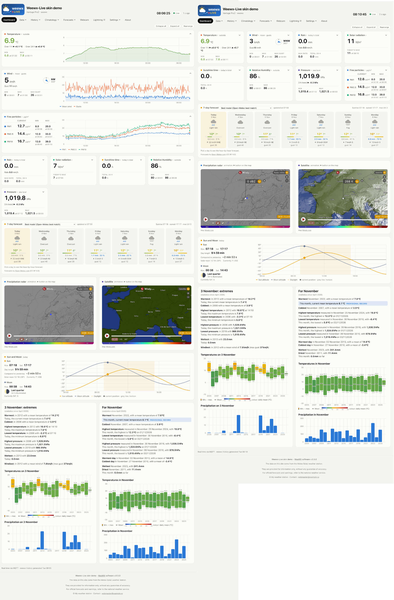

# weewx-live

Site météo en temps réel pour une station pilotée par **weewx**, publié sur un **simple
hébergement web statique** (un accès FTP suffit) : l'ordinateur de weewx reste sur votre
réseau local et n'a pas besoin d'être joignable depuis internet.

*English version: [README.md](README.md).* ·
**Référence complète : [manuel d'utilisation](docs/manual.fr.md).**

Voir la [démo](http://meteo-sciez.fr/weewx/WeewxLive/index.html).



## Ce que vous obtenez

- Un **tableau de bord** : valeur actuelle, minimum et maximum du jour et graphique sur 24 h
  pour chaque mesure, mis à jour à chaque archive weewx ou **en temps réel** (facultatif,
  avec MQTT).
- **Prévisions** (Open-Meteo, 7 jours, heure par heure), cartes **radar et satellite**,
  **Soleil et Lune**, **vigilance météo** (Europe, États-Unis, Canada).
- **Historique** : une page par mesure (de 24 h à 2 ans), archives par jour, mois et année,
  tableaux climatologiques, records de la station.
- Pages **Météogramme** et **Prévisions d'ensemble**.
- Pages en **français, anglais, allemand, italien ou polonais** ; mode clair / sombre et
  **thèmes de couleurs** ; adapté aux smartphones.
- Chaque visiteur peut choisir ses unités, son thème et la disposition du tableau de bord
  (mémorisés par son navigateur).

## Avant de commencer

- **weewx 4.6 ou plus récent** (weewx 5 recommandé), déjà installé et fonctionnel. Pour
  installer weewx lui-même, voir la [documentation de weewx](https://weewx.com/docs/).
- Un hébergement web sur lequel weewx peut envoyer des fichiers (FTP, SFTP ou rsync), ou un
  serveur web local.
- C'est tout : le temps réel (MQTT) est facultatif et peut être ajouté plus tard.

### Quelques mots de weewx

| Mot | Signification |
|---|---|
| `weewx.conf` | fichier de réglages principal de weewx (ex. `/etc/weewx/weewx.conf` ou `~/weewx-data/weewx.conf`) |
| skin | un ensemble de modèles de pages ; celui-ci s'appelle `WeewxLive` |
| `skin.conf` | fichier de réglages du skin, dans `skins/WeewxLive/` (à côté de `weewx.conf`) |
| rapport | une exécution d'un skin, réglée dans `weewx.conf`, section `[StdReport]` |
| archive | l'enregistrement que weewx sauvegarde toutes les quelques minutes (souvent 5) ; les pages sont reconstruites à chacun |
| `HTML_ROOT` | dossier où weewx écrit les pages |

## Installation en 4 étapes

### 1. Installer l'extension

```bash
# weewx 5
weectl extension install https://github.com/Jterrettaz/WeewxLive/releases/download/latest/weewx-live.zip
```

```bash
# weewx 4
sudo wee_extension --install https://github.com/Jterrettaz/WeewxLive/releases/download/latest/weewx-live.zip
```

L'installateur ajoute une section `[[WeewxLive]]` dans `[StdReport]` de `weewx.conf`.

### 2. Choisir où les pages sont écrites

Dans `weewx.conf`, donnez au skin son propre dossier, pour qu'il ne remplace pas les pages du
skin Seasons :

```ini
[StdReport]
    [[WeewxLive]]
        skin = WeewxLive
        enable = true
        HTML_ROOT = public_html/live
```

Avec le paquet Debian / Ubuntu de weewx, indiquez le chemin complet, par exemple
`HTML_ROOT = /var/www/html/weewx/live`.

### 3. Envoyer les pages sur l'hébergement

Activez le rapport FTP de weewx (ou RSYNC), **après** `[[WeewxLive]]` dans `[StdReport]` :

```ini
    [[FTP]]
        skin = Ftp
        enable = true
        user = moncompte
        password = ********
        server = ftp.mon-hebergeur.fr
        path = /www/meteo
        secure_ftp = true
```

Avec cet exemple, les pages sont à l'adresse `https://mon-site/meteo/live/`.
Un serveur web local (pages lues directement dans `HTML_ROOT`) n'a besoin d'aucun envoi.

### 4. Redémarrer weewx et vérifier

```bash
sudo systemctl restart weewx
weectl report run WeewxLive        # weewx 5 : construire les pages tout de suite
```

Ouvrez la page dans votre navigateur. Le badge d'état en haut à droite affiche « Archive
weewx » et l'âge du dernier enregistrement. Ajoutez `?demo` à la fin de l'adresse pour voir la
page avec des données simulées.

## Réglages de base

Tous les réglages ont une valeur par défaut dans `skin.conf`. **Placez dans `weewx.conf`
tout réglage qui diffère de `skin.conf`** : une réinstallation ou une mise à jour de
l'extension remplace `skin.conf`, mais ne touche jamais `weewx.conf`.

Les réglages se placent dans la section `[[WeewxLive]]` de `weewx.conf`. Ceux de la section
`[LiveJSON]` de `skin.conf` vont dans une sous-section `[[[LiveJSON]]]`. **En copiant une
section de `skin.conf`, ajoutez deux niveaux de crochets au nom de chaque section**, car elle
se trouve deux niveaux plus bas :

| Dans `skin.conf` | Dans `weewx.conf` |
|---|---|
| `[LiveJSON]` | `[[[LiveJSON]]]` |
| `[[units]]` | `[[[[units]]]]` |
| `[[[outTemp]]]` (dans `[[parameters]]`) | `[[[[[outTemp]]]]]` |

Ne copiez que les options que vous modifiez. Exemple avec les réglages les plus courants :

```ini
[StdReport]
    [[WeewxLive]]
        skin = WeewxLive
        enable = true
        HTML_ROOT = public_html/live
        lang = fr                      # fr, en, de, it ou pl

        [[[LiveJSON]]]
            station_name = Ma station  # vide : [Station] location de weewx.conf
            timezone = Europe/Paris    # seulement si les heures affichées sont fausses

            [[[[units]]]]              # unités affichées par défaut (modifiables par les visiteurs)
                temperature = °C       # °C, °F
                wind = kmh             # km/h, m/s, mph, kn
                rain = mm              # mm, in
                pressure = hPa         # hPa, inHg, mmHg, kPa

            [[[[appearance]]]]         # apparence par défaut (modifiable par les visiteurs)
                mode = auto            # auto (suit l'appareil), light (clair), dark (sombre)
                theme = classic        # classic, navy, alpage, slate, forest

            [[[[archives]]]]
                day = true             # une page d'archive par jour (désactivé par défaut)
```

Redémarrez weewx après chaque modification de `weewx.conf`.

Chaque réglage est décrit dans le manuel :
[langue](docs/manual.fr.md#langue-des-pages-lang) ·
[unités](docs/manual.fr.md#unités-affichées-units) ·
[apparence](docs/manual.fr.md#apparence--mode-clair--sombre-et-thèmes-de-couleurs-appearance) ·
[pages d'archives](docs/manual.fr.md#archives-pages-jour-mois-année) ·
[heure de la station](docs/manual.fr.md#heure-de-la-station) ·
[conserver ses réglages](docs/manual.fr.md#conserver-ses-réglages-lors-des-mises-à-jour-weewxconf).

## Temps réel (facultatif)

Par défaut, les pages sont mises à jour à chaque archive weewx (toutes les 5 minutes, par
exemple). Avec un broker MQTT joignable depuis internet, les visiteurs voient chaque nouvelle
mesure en quelques secondes. Voir [Temps réel : MQTT](docs/manual.fr.md#3-temps-réel--mqtt-facultatif).

## Mise à jour

Relancez la commande d'installation. Elle remplace `skin.conf` et les fichiers du skin ; vos
réglages de `weewx.conf` sont conservés. Si `skin.conf` avait été modifié, l'ancien est gardé
sous le nom `skin.conf.AAAAMMJJHHMM` : comparez-le avec le nouveau et reportez les réglages
utiles dans `weewx.conf`.

## En cas de problème

- **La page d'accueil du skin Seasons a disparu** : `[[WeewxLive]]` n'a pas son propre
  `HTML_ROOT` (étape 2).
- **La page affiche « Pas de données » ou un bandeau de données anciennes** : les pages ne sont
  pas générées ou pas envoyées. Vérifiez le rapport FTP / RSYNC et le journal de weewx.
- **Les pages ont toujours une archive de retard sur l'hébergement** : `[[WeewxLive]]` doit
  être placé avant `[[FTP]]` / `[[RSYNC]]` dans `weewx.conf` (weewx 5 le fait
  automatiquement ; à la main avec weewx 4).
- **Un réglage est sans effet** : vérifiez le nombre de crochets de chaque section dans
  `weewx.conf`, puis redémarrez weewx.
- **Messages d'erreur** : le skin les écrit dans le journal de weewx, sur les lignes qui
  commencent par `livejson:` (par exemple `journalctl -u weewx | grep livejson`).

## Aller plus loin

Le [manuel d'utilisation](docs/manual.fr.md) décrit tout le reste, notamment :

- [les mesures affichées et leur ordre](docs/manual.fr.md#5-paramètres-affichés-parameters),
  [panneaux groupés](docs/manual.fr.md#panneaux-groupés-plusieurs-mesures-dans-un-panneau),
  [mode admin](docs/manual.fr.md#mode-admin-paramètres-réservés) ;
- [ordre des cadres du tableau de bord et profils](docs/manual.fr.md#ordre-des-cadres-du-tableau-de-bord),
  [logo](docs/manual.fr.md#logo), [pied de page](docs/manual.fr.md#pied-de-page-footer),
  [page « À propos »](docs/manual.fr.md#page--à-propos--about) ;
- [prévisions, radar et satellite](docs/manual.fr.md#prévisions-radar-et-satellite),
  [vigilance météo](docs/manual.fr.md#vigilance-météo-meteoalarm-nws-eccc),
  [webcam](docs/manual.fr.md#webcam-webcam), [éclairs](docs/manual.fr.md#éclairs-lightning) ;
- [archives et climatologie](docs/manual.fr.md#archives-pages-jour-mois-année),
  [records](docs/manual.fr.md#9-page--extrêmes--records-de-la-station),
  [météogramme](docs/manual.fr.md#11-météogramme-meteogramhtml),
  [prévisions d'ensemble](docs/manual.fr.md#10-prévisions-densemble-ensembleshtml) ;
- [ajouter une langue](docs/manual.fr.md#langue-des-pages-lang), thèmes de couleurs (début de
  `skins/WeewxLive/theme.css`).

Évolutions d'une version à l'autre : [journal des modifications](changelog.fr.md).
