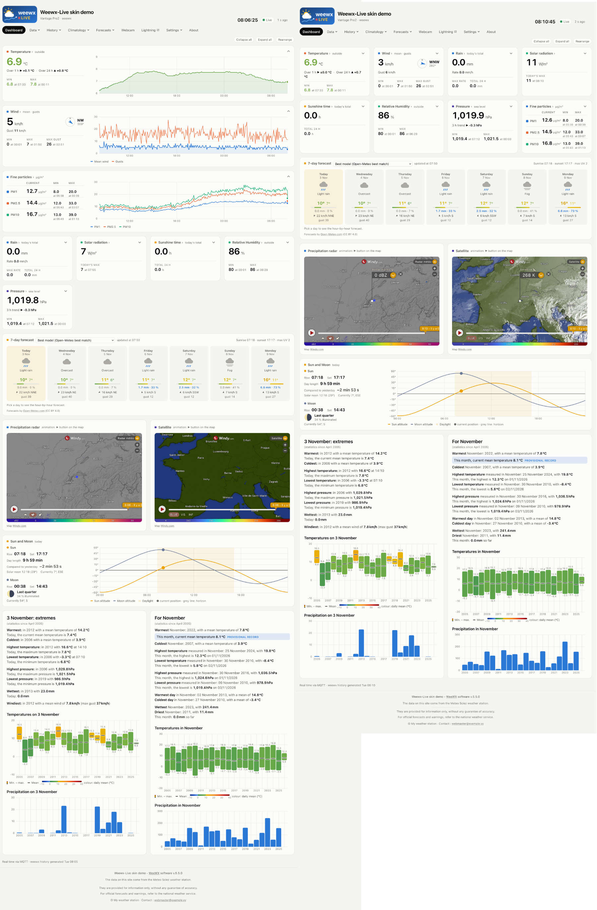

# weewx-live

Real-time weather website for a station run by **weewx**, published on **simple static web
hosting** (FTP is enough): your weewx computer stays on your local network and does not need
to be reachable from the internet.

*Version française : [README.fr.md](README.fr.md).* ·
**Complete reference: [user manual](docs/manual.md).**

See the [demo](http://meteo-sciez.fr/weewx/WeewxLive/index.html).



## What you get

- A **dashboard**: current values, minimum and maximum of the day and 24 h charts for each
  measurement, updated at each weewx archive or **in real time** (optional, with MQTT).
- **Forecasts** (Open-Meteo, 7 days, hour by hour), **radar and satellite** maps,
  **Sun and Moon**, **weather warnings** (Europe, United States, Canada).
- **History**: one page per measurement (24 h to 2 years), archives by day, month and year,
  climatological tables, NOAA reports for every month and year, station records.
- **Meteogram** and **ensemble forecasts** pages.
- Pages in **English, French, German, Italian, Greek or Polish**; light / dark mode and **colour
  themes**; works on smartphones.
- Each visitor can choose their units, theme and dashboard layout (remembered by their
  browser).

## Before you start

- **weewx 4.6 or later** (weewx 5 recommended), already installed and working. To install
  weewx itself, see the [weewx documentation](https://weewx.com/docs/).
- Web hosting where weewx can upload files (FTP, SFTP or rsync), or a local web server.
- That's all: real time (MQTT) is optional and can be added later.

### A few weewx words

| Word | Meaning |
|---|---|
| `weewx.conf` | main weewx settings file (e.g. `/etc/weewx/weewx.conf` or `~/weewx-data/weewx.conf`) |
| skin | a set of page templates; this one is called `WeewxLive` |
| `skin.conf` | settings file of the skin, in `skins/WeewxLive/` (next to `weewx.conf`) |
| report | one run of a skin, configured in `weewx.conf`, section `[StdReport]` |
| archive | the record weewx saves every few minutes (often 5); pages are rebuilt at each one |
| `HTML_ROOT` | folder where weewx writes the pages |

## Installation in 4 steps

### 1. Install the extension

```bash
# weewx 5
weectl extension install https://github.com/Jterrettaz/WeewxLive/releases/download/latest/weewx-live.zip
```

```bash
# weewx 4
sudo wee_extension --install https://github.com/Jterrettaz/WeewxLive/releases/download/latest/weewx-live.zip
```

The installer adds a `[[WeewxLive]]` section to `[StdReport]` in `weewx.conf`.

### 2. Choose where the pages are written

In `weewx.conf`, give the skin its own folder, so that it does not replace the pages of the
Seasons skin:

```ini
[StdReport]
    [[WeewxLive]]
        skin = WeewxLive
        enable = true
        HTML_ROOT = public_html/live
```

With the Debian / Ubuntu package of weewx, give the full path, for example
`HTML_ROOT = /var/www/html/weewx/live`.

### 3. Upload the pages to your web host

Enable the weewx FTP report (or RSYNC), **after** `[[WeewxLive]]` in `[StdReport]`:

```ini
    [[FTP]]
        skin = Ftp
        enable = true
        user = myaccount
        password = ********
        server = ftp.my-host.com
        path = /www/weather
        secure_ftp = true
```

With this example, the pages are at `https://my-site/weather/live/`.
A local web server (pages read directly from `HTML_ROOT`) needs no upload.

### 4. Restart weewx and check

```bash
sudo systemctl restart weewx
weectl report run WeewxLive        # weewx 5: build the pages now, without waiting
```

Open the page in your browser. The status badge at the top right shows "weewx archive" and
the age of the latest record. Add `?demo` at the end of the address to see the page with
simulated data.

## Basic settings

All settings have a default value in `skin.conf`. **Put in `weewx.conf` every setting that
differs from `skin.conf`**: reinstalling or updating the extension replaces `skin.conf`, but
never touches `weewx.conf`.

The settings go in the `[[WeewxLive]]` section of `weewx.conf`. Those of `skin.conf`'s
`[LiveJSON]` section go in a `[[[LiveJSON]]]` subsection. **When you copy a section from
`skin.conf`, add two levels of brackets to each section name**, because it is nested two
levels deeper:

| In `skin.conf` | In `weewx.conf` |
|---|---|
| `[LiveJSON]` | `[[[LiveJSON]]]` |
| `[[units]]` | `[[[[units]]]]` |
| `[[[outTemp]]]` (in `[[parameters]]`) | `[[[[[outTemp]]]]]` |

Copy only the options you change. Example with the most common settings:

```ini
[StdReport]
    [[WeewxLive]]
        skin = WeewxLive
        enable = true
        HTML_ROOT = public_html/live
        lang = en                      # en, fr, de, it or pl

        [[[LiveJSON]]]
            station_name = My station  # empty: [Station] location of weewx.conf
            timezone = Europe/London   # only if the times shown are wrong

            [[[[units]]]]              # units shown by default (visitors can change them)
                temperature = °C       # °C, °F
                wind = kmh             # km/h, m/s, mph, kn
                rain = mm              # mm, in
                pressure = hPa         # hPa, inHg, mmHg, kPa

            [[[[appearance]]]]         # default look (visitors can change it)
                mode = auto            # auto (follows the device), light, dark
                theme = classic        # classic, navy, alpage, slate, forest

            [[[[archives]]]]
                day = true             # one archive page per day (off by default)
```

Restart weewx after each change to `weewx.conf`.

Each setting is described in the manual:
[language](docs/manual.md#page-language-lang) ·
[units](docs/manual.md#displayed-units-units) ·
[appearance](docs/manual.md#appearance-light--dark-mode-and-colour-themes-appearance) ·
[archive pages](docs/manual.md#archives-day-month-year-pages) ·
[station time](docs/manual.md#station-time) ·
[keeping your settings](docs/manual.md#keeping-your-settings-across-updates-weewxconf).

## Real time (optional)

By default, the pages are updated at each weewx archive (every 5 minutes, for example). With an
MQTT broker reachable from the internet, visitors see each new reading within seconds. See
[Real time: MQTT](docs/manual.md#3-real-time-mqtt-optional).

## Updating

Run the installation command again. It replaces `skin.conf` and the skin files; your
settings in `weewx.conf` are kept. If `skin.conf` had been modified, the old one is kept as
`skin.conf.YYYYMMDDHHMM`: compare it with the new one and move the settings you need into
`weewx.conf`.

## If something goes wrong

- **The Seasons skin's home page has disappeared**: `[[WeewxLive]]` has no `HTML_ROOT` of its
  own (step 2).
- **The page shows "No data" or a banner about old data**: the pages are not generated or not
  uploaded. Check the FTP / RSYNC report and the weewx log.
- **The pages are always one archive late on the web host**: `[[WeewxLive]]` must come
  before `[[FTP]]` / `[[RSYNC]]` in `weewx.conf` (weewx 5 does it automatically; move it by
  hand with weewx 4).
- **A setting has no effect**: check the number of brackets of each section in `weewx.conf`,
  then restart weewx.
- **Error messages**: the skin writes them to the weewx log, on lines starting with
  `livejson:` (for example `journalctl -u weewx | grep livejson`).

## Going further

The [user manual](docs/manual.md) describes everything else, including:

- [the measurements shown and their order](docs/manual.md#5-displayed-parameters-parameters),
  [grouped panels](docs/manual.md#grouped-panels-several-measurements-in-one-panel),
  [admin mode](docs/manual.md#admin-mode-reserved-parameters);
- [order of the dashboard frames and profiles](docs/manual.md#order-of-the-dashboard-frames),
  [logo](docs/manual.md#logo), [footer](docs/manual.md#footer-footer),
  ["About" page](docs/manual.md#about-page-about);
- [forecasts, radar and satellite](docs/manual.md#forecasts-radar-and-satellite),
  [weather warnings](docs/manual.md#weather-warnings-meteoalarm-nws-eccc),
  [webcam](docs/manual.md#webcam-webcam), [lightning](docs/manual.md#lightning-lightning);
- [archives and climatology](docs/manual.md#archives-day-month-year-pages),
  [records](docs/manual.md#9-extremes-page-station-records),
  [meteogram](docs/manual.md#11-meteogram-meteogramhtml),
  [ensemble forecasts](docs/manual.md#10-ensemble-forecasts-ensembleshtml);
- [adding a language](docs/manual.md#page-language-lang), colour themes (top of
  `skins/WeewxLive/theme.css`).

Changes between versions: [changelog](changelog.md).
